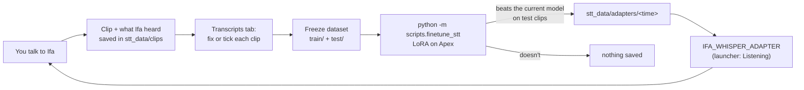

# Fine-tuning speech-to-text on your voice

**Files:** [ifa/services/transcripts.py](../../ifa/services/transcripts.py) (collect, review, freeze), [scripts/finetune_stt.py](../../scripts/finetune_stt.py) (train), [ifa/voice/stt.py](../../ifa/voice/stt.py) (load the adapter), the launcher's Transcripts tab.

## The loop



## Steps

1. **Collect.** Use Ifa normally. Every transcription is saved with its audio (`IFA_STT_COLLECT`, on by default).
2. **Review.** In the Transcripts tab, play each clip, fix the text, press Enter. Delete clips that aren't your voice.
3. **Freeze.** Press *Freeze dataset*. Every 5th reviewed clip goes to `test/`, which training never learns from.
4. **Train.** Stop Ifa (it needs the GPU), then on the PC:
   ```
   venv\Scripts\python -m scripts.finetune_stt
   ```
   It uses the newest frozen dataset and Ifa's current model, prints the word error rate before and after each epoch, and shows a few clips that changed.
5. **Use it.** Put the printed folder in *Voice adapter* (`IFA_WHISPER_ADAPTER`) and restart Ifa. The log says `[whisper] using the voice adapter …`. Clear the setting to go back.

> [!TIP]
> Aim for 300+ reviewed clips. Fewer than ~100 mostly teaches the model those exact sentences (overfitting), and the script will usually refuse to save.

## Why it's built this way

- **LoRA (PEFT), not full fine-tuning.** Only ~1–2% of the weights are trained: small matrices on every attention projection in the encoder (how you sound) and decoder (how you phrase things). The adapter is a few MB, can't damage the base model, and fits the 4060 Ti next to nothing else.
- **A held-out test set as the gate.** The adapter is saved only if it beats the current model on clips it never trained on. Training loss always goes down; that alone proves nothing.
- **Same settings as Ifa.** Training and evaluation use the `en` language token and the same model, so the measured gain is the gain you'll hear.
- **Merged at load.** `merge_and_unload()` folds the adapter into the weights, so transcription is exactly as fast as before.
- **Plain PyTorch loop.** No `datasets`/`Trainer` stack: the only extra packages are `peft` and `accelerate`.

## Settings for the script

| Flag | Default | What it does |
|---|---|---|
| `--data` | newest in `stt_data/datasets/` | Which frozen dataset |
| `--epochs` | 5 | Passes over the training clips; the best epoch is kept |
| `--lr` | 5e-4 | Learning rate. Lower if the test error rises from epoch 1 |
| `--rank` | 16 | LoRA size. Bigger learns more and overfits sooner |
| `--batch` | 8 | Clips per step. Lower it if CUDA runs out of memory |

## Where it can fail

| Symptom | Cause | Fix |
|---|---|---|
| `No frozen dataset yet` | Nothing frozen | Review clips, press Freeze dataset |
| `has no test clips` | Fewer than 5 reviewed clips | Review more, freeze again |
| `never beat the current model` | Too little data, or learning rate too high | More clips; try `--lr 2e-4` |
| CUDA out of memory | Ifa still running, or batch too big | Stop Ifa; `--batch 4` |
| Ifa won't start after setting the adapter | Wrong folder, or adapter from another base model | Clear `IFA_WHISPER_ADAPTER`; check `report.json` in the folder for `base_model` |
