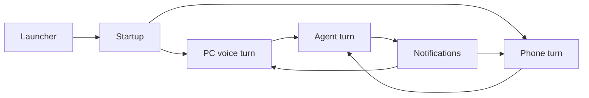

# Ifa flows

How Ifa actually runs, one flow per note: what happens step by step, which file does it, what the logs say when it breaks, and which setting changes it. For the big picture, see [ARCHITECTURE.md](../ARCHITECTURE.md). For why things are built this way, see [decisions.md](../decisions.md) and the [design docs](../design/).

| Note | Covers |
|---|---|
| [Startup](startup.md) | From "Start" to listening: env, offline mode, models, tools, servers |
| [PC voice turn](voice-turn-pc.md) | Wake word → capture → voice check → speech-to-text → spoken reply → follow-up |
| [Phone turn](phone-turn.md) | Discovery, pairing, the WebSocket messages, streaming audio both ways |
| [Agent turn](agent-turn.md) | Prompt, Ollama streaming, the tool loop, guards, memory, plus the full tool catalogue |
| [Notifications](notifications.md) | Phone notification → inbox → urgency check → announcement → read-out → history |
| [Launcher](launcher.md) | The web UI: settings, setup steps, start/stop, Send logs |

## How to read a flow note

Every note has the same sections:

- **Diagram:** the flow at a glance.
- **Steps:** each step with the file and function that does it.
- **Where it can fail:** symptom, the exact log line to search for, cause, and fix. Start here when debugging.
- **Settings:** the `.env` / launcher settings that change the flow.
- **Patterns:** the architecture patterns used, and why.

> [!TIP]
> Debugging a problem? Find the symptom in a note's **Where it can fail** table, then search the logs (launcher → Send logs) for the quoted log line.

> [!NOTE]
> These notes name functions, not line numbers, so they stay correct as code moves. When a flow changes, update its note and the `updated:` date.
