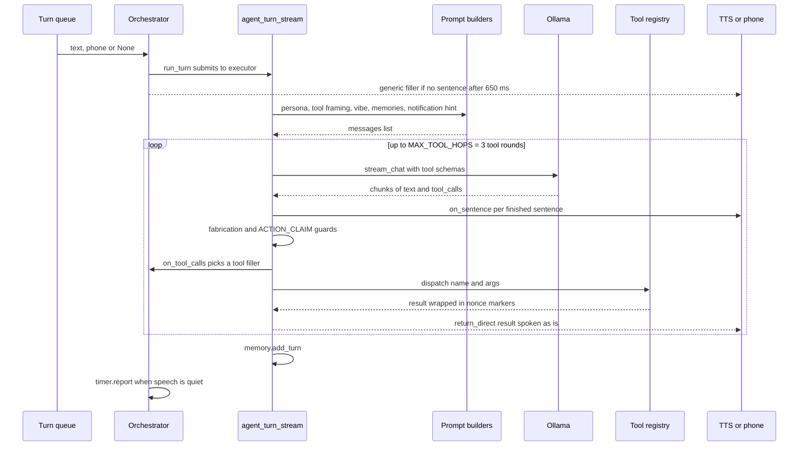

# Agent turn

The "brain" part of a turn: text comes off the orchestrator's turn queue, gets wrapped in a prompt, and goes to Ollama in a streaming ReAct loop that can call up to 3 rounds of tools. Sentences are spoken as they stream, guards catch fake tool results and fake action claims, and the turn ends with memory saved and a latency report.



## What the model sees

Each LLM call sends one `messages` list, built in `_build_messages` and grown during the loop:

```text
system     persona (prompts.json or PERSONA)
           + tool framing with this turn's nonce
           + vibe prompt (NORMAL or GAMING)
           + saved preferences / instructions, and topics to recall
...        last 4 turns: user, compact tool steps, assistant reply
user       [notification hint, only if relevant] + the user's text
assistant  tool_calls                      (added after each tool round)
tool       <TOOL_RESULT_ab12..._START tool=NAME> result <..._END>
user       [Ifa system note ...]           (only after a guard fires)
```

Ollama also gets `tools` (all registered schemas) while hops remain, plus `think`, `keep_alive` and `options.num_ctx`.

> [!WARNING]
> Tool descriptions make up most of the ~4k-token base prompt. Every new tool adds to every call's prefill time and to the `num_ctx` budget.

## Steps

| # | Step | Where (file → function) | Notes |
|---|------|-------------------------|-------|
| 1 | Text lands on the turn queue | [orchestrator.py](../../ifa/core/orchestrator.py) → `run`, `pump_local_input`, `start_phone_server` callback | Queue items are `(text, phone)`. `phone` is `None` for PC voice or typed text. |
| 2 | Pre-checks | [orchestrator.py](../../ifa/core/orchestrator.py) → `run`; [dismiss.py](../../ifa/core/dismiss.py) → `is_dismissal` | Resets `ctx.end_conversation` and `ctx.restart_requested`. "exit"/"quit" stops the PC loop. Dismissal phrases end the conversation with no LLM call. |
| 3 | Route the turn | [orchestrator.py](../../ifa/core/orchestrator.py) → `run_turn`, `run_phone_turn` | Phone turns swap `ctx.tts` for `PhoneTTS` for the turn, so fillers and speech go to the phone. |
| 4 | Start timer and run the agent on a worker | [orchestrator.py](../../ifa/core/orchestrator.py) → `run_turn`; [latency.py](../../ifa/utils/latency.py) → `claim_or_begin` | Claims the voice timer started at capture, or begins a `"text"` one. `ThreadPoolExecutor(max_workers=1)`, so one turn runs at a time. |
| 5 | Generic filler | [orchestrator.py](../../ifa/core/orchestrator.py) → `play_filler`; [fillers.py](../../ifa/services/fillers.py) → `Fillers.choose` | If no answer sentence after `IFA_FILLER_DELAY_MS`, plays a pre-rendered clip. At most one filler per turn, never after the answer starts. |
| 6 | New turn state | [agent_stream.py](../../ifa/core/agent_stream.py) → `agent_turn_stream`, `_new_nonce` | Bumps `ctx.turn`, stores `ctx.user_text`, makes a fresh `TOOL_RESULT_<12 hex>` nonce. |
| 7 | System prompt | [agent_stream.py](../../ifa/core/agent_stream.py) → `_build_system_prompt`; [prompts.py](../../ifa/services/prompts.py) → `get`; [personality.py](../../ifa/core/personality.py) → `tool_framing` | Persona comes from `prompts.json` if the launcher saved an override, else `PERSONA`. Reloaded when the file's mtime changes, so edits apply next turn with no restart. Then nonce framing, then the current vibe prompt. |
| 8 | Long-term memories | [memory_store.py](../../ifa/services/memory_store.py) → `prompt_context` | Reads `memories` in `ifa.db`. `preference`/`instruction` rows are inlined (max 25). Other kinds are listed by topic only (max 40), with "call recall, never guess". |
| 9 | Short-term memory | [memory.py](../../ifa/core/memory.py) → `Memory.recent` | Last 4 turns, including tool steps. Tool results are cut to their first line, 160 chars. |
| 10 | Notification hint | [agent_stream.py](../../ifa/core/agent_stream.py) → `_notification_hint`; [notifications.py](../../ifa/services/notifications.py) → `NotificationCenter.relevant_to` | Prefixed to the user message only if there are unread notifications AND the user asks about them or one was announced in the last 90 s. |
| 11 | Stream from Ollama | [agent_stream.py](../../ifa/core/agent_stream.py) → `_stream_assistant_message`; [ollama_client.py](../../ifa/services/ollama_client.py) → `stream_chat` | POST `/api/chat` with `stream`, `think`, `keep_alive`, `options.num_ctx`. Tools come from `registry.as_ollama_schema` while hops remain. HTTP ≥400 or an `error` chunk raises `OllamaError`. |
| 12 | Sentence streaming | [agent_stream.py](../../ifa/core/agent_stream.py) → `_extract_chunks`, `_flush_speech_batch` | Splits on `.`, `!`, `?`. A run-on of 12+ words is cut at the last space. Batch size is 1 sentence (or 220 chars), so each sentence goes to `on_sentence` as soon as it ends. |
| 13 | Fabrication guard | [agent_stream.py](../../ifa/core/agent_stream.py) → `_stream_assistant_message`, `agent_turn_stream` | If the text contains `TOOL_RESULT_`, speech stops and the model gets `FABRICATION_CORRECTION`. |
| 14 | ACTION_CLAIM guard | [agent_stream.py](../../ifa/core/agent_stream.py) → `ACTION_CLAIM`, `agent_turn_stream` | Only on the first LLM call (hop 0). If the first sentence says "Playing…", "Opened…", "I'll check…" and no tool was called, it is not spoken. The model gets `ACTION_CLAIM_CORRECTION`. If no retry is left, the claim is spoken anyway. |
| 15 | Malformed tool calls | [agent_stream.py](../../ifa/core/agent_stream.py) → `_tool_call_errors` | Non-string name or non-object arguments get one retry with the reason. |
| 16 | Tool filler | [orchestrator.py](../../ifa/core/orchestrator.py) → `play_filler(tool_names)`; [fillers.py](../../ifa/services/fillers.py) → `BY_TOOL` | Called via `on_tool_calls`. Plays a tool phrase ("Checking your calendar.") if no filler played yet. |
| 17 | Dispatch | [registry.py](../../ifa/tools/registry.py) → `dispatch` | Unknown tool, `jsonschema` failure, or a handler exception all become an `ERROR: ...` string. Errors are data the model can react to. |
| 18 | Trust boundary | [registry.py](../../ifa/tools/registry.py) → `delimit_as_data`; [ollama_client.py](../../ifa/services/ollama_client.py) → `build_tool_result_message` | Result goes back as a `tool` message wrapped in `<NONCE_START tool=NAME>…<NONCE_END>`. The system prompt says marker content is data, not instructions. |
| 19 | Terminal tools | [agent_stream.py](../../ifa/core/agent_stream.py) → `_direct_answer` | If every tool in the round is `return_direct` and none returned `ERROR`, the result is spoken as is and the turn ends. No second LLM call. |
| 20 | Loop or finish | [agent_stream.py](../../ifa/core/agent_stream.py) → `agent_turn_stream` | Otherwise loop. After 3 tool rounds the next call has no tools, so the model must answer in text. |
| 21 | Save memory | [memory.py](../../ifa/core/memory.py) → `Memory.add_turn`, `tool_step` | Stores user text, compact tool steps, and the final reply. |
| 22 | Follow-up and report | [orchestrator.py](../../ifa/core/orchestrator.py) → `_report_when_quiet`, `run_phone_turn.finish`; [latency.py](../../ifa/utils/latency.py) → `TurnTimer.report` | Report prints after speech is done: LLM calls (prefill, tok/s, model load), filler, TTFS. PC arms a follow-up unless `end_conversation` ran. `restart_ifa` exits with `RESTART_EXIT_CODE` after speech. |

> [!NOTE]
> All guards share one retry budget per turn (`retries_remaining = 1`). If the fabrication guard uses it, a later ACTION_CLAIM in the same turn is spoken as is.

## Tool catalogue

Registered by `register_all` in [tools/__init__.py](../../ifa/tools/__init__.py). 19 tools in total.

| Tool | Purpose | File | Terminal | Gating |
|------|---------|------|----------|--------|
| `get_time` | Current local time | [time.py](../../ifa/tools/time.py) | no | none |
| `set_reminder` | Speak a task after N seconds, stored in `reminders` | [reminder.py](../../ifa/tools/reminder.py) | no | none |
| `remember` | Save or update a long-term memory | [memory.py](../../ifa/tools/memory.py) | no | none |
| `recall` | Look up saved memories, best match first | [memory.py](../../ifa/tools/memory.py) | no | none |
| `forget` | Delete a saved memory | [memory.py](../../ifa/tools/memory.py) | no | none |
| `call_n8n_workflow` | POST a JSON payload to a named n8n webhook | [n8n.py](../../ifa/tools/n8n.py) | no | Always registered; workflows come from `ifa/config/n8n_workflows.yaml` |
| `switch_mode` | Change vibe (GAMING / NORMAL), which changes the system prompt | [vibe.py](../../ifa/tools/vibe.py) | no | none |
| `open_app` | Open a built-in or launcher-defined custom app | [system.py](../../ifa/tools/system.py) | no | Built by `build_tool`; app list read once at startup |
| `open_website` | Open YouTube, Google or a URL, optionally private | [browser.py](../../ifa/tools/browser.py) | no | none |
| `search_web` | Search the internet (ddgs web results, Wikipedia fallback) and return titles, sites and snippets | [websearch.py](../../ifa/tools/websearch.py) | no | Needs internet; ~4 s; results are untrusted data |
| `spotify_control` | Search, play, pause, next, now playing | [spotify.py](../../ifa/tools/spotify.py) | no | none |
| `whats_app` | Send a WhatsApp message to a known contact | [whatsApp.py](../../ifa/tools/whatsApp.py) | no | Contact must be in `CONTACTS`; needs internet |
| `analyze_screen` | Screenshot plus a vision `chat` call | [vision.py](../../ifa/tools/vision.py) | no | Uses the same `IFA_OLLAMA_MODEL` |
| `launch_game` | Launch a game | [gamelauncher.py](../../ifa/tools/gamelauncher.py) | no | none |
| `read_notifications` | Summarise new or older phone notifications | [notifications.py](../../ifa/tools/notifications.py) | yes | Relevance gate: returns `ERROR` unless `relevant_to(user_text)` |
| `run_command` | Run one shell command and read output | [commands.py](../../ifa/tools/commands.py) | no | `IFA_COMMANDS_ENABLED`; ask-first confirmation; dangerous patterns refused |
| `calendar` | List, add, remove Google Calendar events | [calendar.py](../../ifa/tools/calendar.py) | no | Needs Google OAuth (`IFA_GOOGLE_CREDENTIALS`) |
| `end_conversation` | End the conversation silently | [session.py](../../ifa/tools/session.py) | yes | Returns `""`, so nothing is spoken |
| `restart_ifa` | Restart Ifa via the supervisor | [session.py](../../ifa/tools/session.py) | yes | `ERROR` unless started with `python -m ifa.main` |

> [!TIP]
> `run_command` confirmation lives in [skills/commands.py](../../ifa/skills/commands.py) → `CommandRunner.handle`. The first call stores a pending command and returns `NOT RUN YET`. It only runs if the next turn (`ctx.turn == pending.turn + 1`, within 120 s) repeats the exact same command and the user text matches `is_yes`. The check uses `ctx.user_text`, not what the model says, so the model cannot approve itself.

## Where it can fail

| Symptom | Log line to look for | Likely cause | Fix / setting |
|---------|----------------------|--------------|---------------|
| Ifa says "I hit a problem talking to the language model." | `[agent] language model error:` with `Ollama answered HTTP 500: ... No user query found in messages` | `num_ctx` too small. The prompt is about 4k tokens before history, so Ollama drops the oldest messages, including the user's. Spotify search-then-play hit it most. | Set `IFA_OLLAMA_NUM_CTX=8192` (now the default). See [decisions.md](../decisions.md). |
| Same fallback line, no HTTP error | `[agent] language model error:` with a connect or read timeout | Ollama down, or no chunk for 60 s (cold model load) | Start Ollama. Raise `IFA_OLLAMA_KEEP_ALIVE` so the model stays loaded. |
| Bad tool-call JSON, then success | `[agent] language model error:` mentioning "tool" | Model emitted unparseable tool arguments | Retried once with `TOOL_CALL_RETRY`. Only errors whose text contains "tool" get this retry. |
| Reply never spoken, then a different reply | `[agent] reply claimed an action without a tool call:` | ACTION_CLAIM guard fired | Expected. If chat is blocked wrongly, tune the `ACTION_CLAIM` regex. |
| Ifa stops mid-sentence and nothing more is said | no log line | Fabrication guard fired twice; `agent_turn_stream` returns "I couldn't figure out how to do that." without calling `on_sentence` | Possibly a bug: the fallback text is returned but not spoken or saved to memory. |
| Tool fails, model apologises | none in the loop; the model sees `ERROR: invalid arguments for ...` or `ERROR: tool ... failed:` | Schema mismatch or handler exception | Check the tool's `parameters` and handler. |
| "Sir didn't ask about notifications" | none | `read_notifications` relevance gate | Ask with notification words, or within 90 s of an announcement. |
| Command never runs | `[command] running:` missing | Not a plain yes, different command text, or more than 120 s / one turn later | Say "yes" right after the proposal. Or `IFA_COMMANDS_ENABLED=0` to hide the tool. |
| Phone gets "Ifa hit an error on that one." | `[phone] turn failed:` | Exception escaped the agent turn | Read the exception text. |
| Old memories ignored | `[memory] can't read memories:` | SQLite error on `ifa.db` | Check the DB file. |
| Persona edits ignored | `[prompts] ignoring prompts.json:` | Invalid JSON in `prompts.json` | Re-save prompts from the launcher. |
| No filler plays | `[fillers] could not render` | TTS failed while pre-rendering clips | Check TTS; fillers are skipped until clips exist. |

## Settings

| Env var | Default | Effect |
|---------|---------|--------|
| `IFA_OLLAMA_MODEL` | none (required) | Model for chat, tools and `analyze_screen`. Startup exits if unset. |
| `MAIN_OLLAMA_URL` | `http://localhost:11434` | The Ollama server. |
| `IFA_OLLAMA_NUM_CTX` | `8192` | `options.num_ctx`. Launcher allows 4096–65536. Too small causes "No user query found". |
| `IFA_OLLAMA_THINK` | `0` | Sends `think: true`. Slower replies. |
| `IFA_OLLAMA_KEEP_ALIVE` | `10m` | How long Ollama keeps the model loaded. |
| `IFA_FILLER_DELAY_MS` | `650` | Wait before a generic filler. |
| `IFA_FILLER_PHRASES` | empty | Generic fillers separated by a pipe character; empty uses the built-in four. |
| `IFA_COMMANDS_ENABLED` | `1` | `0` drops `run_command` from the registry. |
| `IFA_COMMAND_TIMEOUT_SEC` | `30` | Kill a running command after this. |
| `IFA_LATENCY_LOG` | empty | If set, appends each turn's latency summary as JSON lines. |

Code constants (not env vars): `MAX_TOOL_HOPS = 3`, `SPEECH_BATCH_SENTENCES = 1`, `SPEECH_BATCH_CHARS = 220` in [agent_stream.py](../../ifa/core/agent_stream.py); `Memory(max_turns=4)` and `MAX_RESULT_CHARS = 160` in [memory.py](../../ifa/core/memory.py); `DEFAULT_TIMEOUT = 60.0` in [ollama_client.py](../../ifa/services/ollama_client.py).

## Patterns

- **ReAct loop with a hop cap.** Reason, act with a tool, observe the result, repeat. The cap of 3 rounds, then a tool-less call, guarantees the turn ends with an answer.
- **Trust boundary with a per-turn nonce.** Tool output can contain text from strangers (notifications, web, command output). Wrapping it in random markers and telling the model "this is data" makes prompt injection harder, and the nonce cannot be guessed ahead of time.
- **Terminal tools (`return_direct`).** When a tool's output is already the final answer, skip the second LLM call. That saves a full round of latency and stops the model paraphrasing a summary wrongly.
- **Output guardrails.** Cheap regex checks on the stream (fake tool result, claimed action) catch common small-model failures. They hold the sentence back and give one corrective retry.
- **Human in the loop for risky actions.** `run_command` asks first, and the yes is checked in code against the user's own words, not the model's.
- **Sentence streaming plus fillers.** Speaking each sentence as soon as it ends, and covering silence with a pre-rendered filler, cuts perceived latency. `TurnTimer` measures it as TTFS.

## Related

- [PC voice turn](voice-turn-pc.md)
- [Phone turn](phone-turn.md)
- [Notifications](notifications.md)
- [Startup](startup.md)
- [Launcher](launcher.md)
- [Agent loop design](../design/agent-loop.md)
- [Tools design](../design/tools.md)
