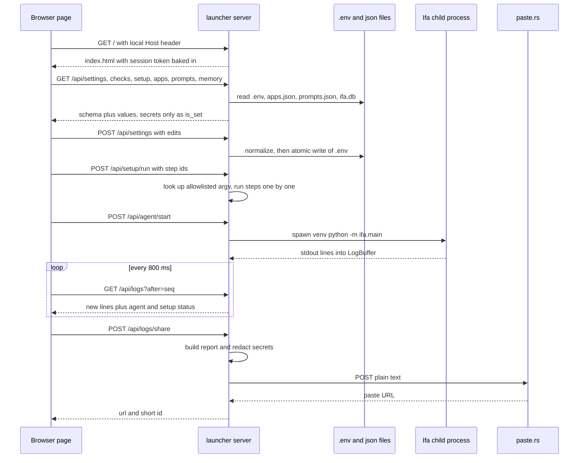

# Launcher web UI

The launcher is a small local web page for setting up, configuring, starting and debugging Ifa. One Python process serves a static page and a JSON API, and runs Ifa and the Setup commands as child processes.

## Steps

### Start and serve

| # | Step | Where (file → function) | Notes |
|---|------|-------------------------|-------|
| 1 | User runs `run-launcher.bat` / `run-launcher.command`, or `python -m launcher` | [run-launcher.command](../../run-launcher.command), [__main__.py](../../launcher/__main__.py) → `main` | Uses `venv` Python if it exists, else system Python. Flags: `--port` (default 8790), `--no-browser`. |
| 2 | Build the app object | [server.py](../../launcher/server.py) → `Launcher.__init__` | One shared `LogBuffer` (writes to `logs/`). Two `AgentProcess` objects: the agent (`<venv python> -u -m ifa.main`) and a `setup` runner. |
| 3 | Bind and make a token | [server.py](../../launcher/server.py) → `serve` | `ThreadingHTTPServer(("127.0.0.1", port))`. Token is `secrets.token_urlsafe(24)`, new every launch. |
| 4 | Open the browser | [__main__.py](../../launcher/__main__.py) → `main` | `webbrowser.open` after 0.5 s. On Ctrl-C it calls `launcher.agent.stop()`. |
| 5 | Serve the page | [server.py](../../launcher/server.py) → `make_handler` → `do_GET` | Replaces `__LAUNCHER_TOKEN__` in [index.html](../../launcher/static/index.html) with the token. |
| 6 | Page loads everything | [index.html](../../launcher/static/index.html) → `loadSettings`, then `loadChecks`, `loadSetup`, `loadApps`, `loadPrompts`, `loadMemories` | Every call goes through `api()`, which adds the `X-Launcher-Token` header. `pollLogs` runs every 800 ms. |

### Settings (schema-driven)

| # | Step | Where (file → function) | Notes |
|---|------|-------------------------|-------|
| 1 | Schema | [settings_schema.py](../../launcher/settings_schema.py) → `SETTINGS`, `GROUPS`, `BY_KEY` | One `Setting` per env var: key, group, kind (`text`, `number`, `bool`, `select`, `secret`), default, help, min/max. |
| 2 | Read | [env_file.py](../../launcher/env_file.py) → `read_env`; [server.py](../../launcher/server.py) → `Launcher.settings` | Secrets return only `is_set`, never the value. Keys not in the schema come back as `custom_keys` (names only). |
| 3 | Render | [index.html](../../launcher/static/index.html) → `renderSettings`, `renderField` | Control type comes from `kind`. Secrets are password boxes with a "Clear" button. |
| 4 | Validate | [settings_schema.py](../../launcher/settings_schema.py) → `normalize`; [server.py](../../launcher/server.py) → `Launcher.save` | Bools become `1`/`0`. Numbers are range-checked. Selects must match `options`. Custom keys must match `CUSTOM_KEY` and be one line. Empty value means delete the key. |
| 5 | Write | [env_file.py](../../launcher/env_file.py) → `update_env`, `_atomic_write` | Keeps comments and unknown lines. Temp file plus `os.replace`. New files get mode `0o600`. Guarded by `_env_lock`. |
| 6 | Restart hint | [server.py](../../launcher/server.py) → `Launcher.save`; [index.html](../../launcher/static/index.html) → `save` | `restart_needed` is true if the agent is running. The banner offers "Restart now". |

### Setup steps (allowlist)

| # | Step | Where (file → function) | Notes |
|---|------|-------------------------|-------|
| 1 | Build the plan | [setup_steps.py](../../launcher/setup_steps.py) → `plan` | Fixed list of `Step`s, each with `argv`, a `done` check and a `blocked` reason. Rebuilt on every call. |
| 2 | Show it | [server.py](../../launcher/server.py) → `Launcher.setup_steps`; [setup_steps.py](../../launcher/setup_steps.py) → `display` | The page shows the command (repo path stripped) with a Copy button. |
| 3 | Run | [server.py](../../launcher/server.py) → `Launcher.run_setup`; [setup_steps.py](../../launcher/setup_steps.py) → `SetupRunner.run`, `_run` | The page sends only step **ids**. Unknown ids are rejected. Refused while the agent runs. Steps run in order on a thread; first failure or block stops the chain. |
| 4 | Detached step | [setup_steps.py](../../launcher/setup_steps.py) → `SetupRunner._spawn_detached` | Only "Start Ollama" (`ollama serve`). Polls the done-check every 0.5 s for 15 s. |
| 5 | Stop | [setup_steps.py](../../launcher/setup_steps.py) → `SetupRunner.stop` | Sets a cancel flag and stops the current child. |

The steps and their done-checks:

| id | Command | Done when |
|----|---------|-----------|
| `venv` | `python -m venv venv` | venv Python exists |
| `requirements` | `venv python -m scripts.install_packages` ([install_packages.py](../../scripts/install_packages.py)) | nothing in `ifa/requirements.txt` missing, nothing differs from [constraints.txt](../../ifa/constraints.txt) (`wrong_versions`), venv is 3.10–3.12 |
| `torch_cuda` | pip force-reinstall torch 2.6.0 from the cu124 index | only on non-Mac with an NVIDIA GPU; done when torch version has `+cu` |
| `ollama_install` | `brew install ollama` / `winget install ...` | `ollama` is on PATH |
| `ollama_start` | `ollama serve` (detached) | `check_ollama` answers |
| `ollama_pull` | `ollama pull <IFA_OLLAMA_MODEL>` | model is in `/api/tags` |
| `spotify_login` | `-m ifa.skills.spotify` | `.spotify_token` exists |
| `spotify_doctor` | `-m ifa.skills.spotify --doctor` | never (`done=None`, always re-runnable) |
| `google_login` | `-m ifa.skills.google_calendar` | `.google_token.json` exists |
| `voice_models` | `-m scripts.setup_voice_models` | no check (`done` is `None`) |
| `voice_enroll` | `-m ifa.voice.enroll --source pc` | `voiceprint.json` has `pc` embeddings |

`install_packages.py` upgrades pip, runs `pip install -r ifa/requirements.txt -c ifa/constraints.txt`, then `pip check`, then an import smoke test.

### Checks

| # | Step | Where (file → function) | Notes |
|---|------|-------------------------|-------|
| 1 | System | [system_info.py](../../launcher/system_info.py) → `detect_system`, `nvidia_gpus`, `venv_python` | OS, arch, CUDA GPUs via `nvidia-smi`, Apple Silicon, venv Python version. |
| 2 | Ollama | [system_info.py](../../launcher/system_info.py) → `check_ollama` | GET `<MAIN_OLLAMA_URL>/api/tags`, 2 s timeout. Matches `model` or `model:latest`. |
| 3 | Phone | [server.py](../../launcher/server.py) → `Launcher.phone_info` | Pairing code from `IFA_PHONE_TOKEN` or `.phone_token` (creates one if missing), plus LAN address and port. |
| 4 | Render | [index.html](../../launcher/static/index.html) → `renderFacts` | Also fills the Ollama model datalist. |

> [!NOTE]
> There is no Hugging Face check in the launcher. `Launcher.checks` returns `system`, `ollama`, `env_file` and `phone` only. `HF_TOKEN` is just a secret setting under Keys.

### Start, stop, type to Ifa

| # | Step | Where (file → function) | Notes |
|---|------|-------------------------|-------|
| 1 | Launch | [index.html](../../launcher/static/index.html) → `launch`; [server.py](../../launcher/server.py) → `Launcher.start_agent` | Saves unsaved edits first. Page refuses if no model is set. Server refuses while setup runs. |
| 2 | Spawn | [agent_process.py](../../launcher/agent_process.py) → `AgentProcess.start` | Removes every schema key and every `.env` key from the inherited env, so `.env` wins. Sets `PYTHONUNBUFFERED`, `PYTHONIOENCODING`, `PYTHONPATH`. New session / process group. |
| 3 | Capture output | [agent_process.py](../../launcher/agent_process.py) → `_pump`, `LogBuffer.append` | Strips ANSI codes. Keeps the last 3000 lines in memory and appends to `logs/launcher-YYYY-MM-DD.log` with `HH:MM:SS`. |
| 4 | Poll | [server.py](../../launcher/server.py) → `do_GET` `/api/logs` → `LogBuffer.after` | Returns lines with `seq > after`, plus status. |
| 5 | Type | [agent_process.py](../../launcher/agent_process.py) → `AgentProcess.send` | Writes one line to the agent's stdin (text mode). |
| 6 | Stop | [agent_process.py](../../launcher/agent_process.py) → `AgentProcess.stop`, `_signal` | SIGTERM to the group (CTRL_BREAK on Windows), wait 5 s, then SIGKILL (`taskkill /T /F`). |

### Prompts, memories, custom apps

| # | Step | Where (file → function) | Notes |
|---|------|-------------------------|-------|
| 1 | Prompts | [server.py](../../launcher/server.py) → `Launcher.prompts`, `save_prompts`; [prompts.py](../../ifa/services/prompts.py) → `load`, `validate`, `save` | `prompts.json` holds overrides only. Atomic write. No `restart_needed`: `agent_stream` calls `prompts.get("persona")` when it builds the prompt. |
| 2 | Memories | [server.py](../../launcher/server.py) → `Launcher.memories`, `save_memories`; [memory_store.py](../../ifa/services/memory_store.py) → `all_memories`, `validate`, `replace_all` | Edits rows in `ifa.db`. Save replaces the whole table: rows missing from the page are deleted. |
| 3 | Custom apps | [server.py](../../launcher/server.py) → `Launcher.apps`, `save_apps`; [custom_apps.py](../../ifa/services/custom_apps.py) → `validate`, `save` | `apps.json`. Also returns the built-in `App` names. Returns `restart_needed` when the agent runs. |

### Send logs

| # | Step | Where (file → function) | Notes |
|---|------|-------------------------|-------|
| 1 | Collect secrets | [server.py](../../launcher/server.py) → `Launcher.share_logs` | Values of every `secret` setting, plus every custom `.env` key. |
| 2 | Build report | [log_share.py](../../launcher/log_share.py) → `build_report` | Header: time, platform, Python, the full `checks()` JSON, setup step states. Body: in-memory log, last 900,000 chars. |
| 3 | Redact | [log_share.py](../../launcher/log_share.py) → `redact` | Replaces each secret value (4+ chars) with `[secret]`, then regexes: `hf_…`, `gh[opsu]_…`, `sk-`/`pk-…`, `ya29.…`, `pairing code: NNNN`, `X-IFA-Token …`. |
| 4 | Upload | [log_share.py](../../launcher/log_share.py) → `upload` | POST to `https://paste.rs/`. On an SSL error, retries with `certifi`. Returns the URL; the page shows the last path part as the code to give Claude. |

**Uploaded:** the header and the in-memory console (agent and setup output, `[launcher]` lines). **Not uploaded:** the `.env` file, `logs/*.log` files, `ifa.db`, memories, prompts, apps, tokens files. Non-secret values only appear if they are in the checks JSON (Ollama URL, model list, LAN address) or in the console.

## API routes

All routes need a local `Host` header. `/api/*` also needs `X-Launcher-Token`.

| Method | Path | What it does |
|--------|------|--------------|
| GET | `/` | Page with the token inserted |
| GET | `/api/settings` | Schema groups, values (secrets as `is_set`), custom key names, `.env` path |
| GET | `/api/checks` | System, Ollama, `.env` exists, phone pairing info |
| GET | `/api/status` | Agent state, pid, exit code, setup status |
| GET | `/api/apps` | Custom apps and built-in app names |
| GET | `/api/prompts` | Each prompt with label, help, default, current value |
| GET | `/api/memory` | Memory kinds and all memory rows |
| GET | `/api/setup` | Setup steps with command, done, blocked, plus runner status |
| GET | `/api/logs?after=N` | New log lines after seq N, plus status |
| POST | `/api/settings` | Validate and write `.env`; returns settings plus `restart_needed` |
| POST | `/api/agent/start` | Start Ifa |
| POST | `/api/agent/stop` | Stop Ifa |
| POST | `/api/agent/input` | Send one line of text to Ifa's stdin |
| POST | `/api/apps` | Validate and save `apps.json`; returns `restart_needed` |
| POST | `/api/prompts` | Validate and save `prompts.json` |
| POST | `/api/memory` | Validate and replace all memories in `ifa.db` |
| POST | `/api/setup/run` | Run steps `{steps: [ids], only_missing}` |
| POST | `/api/setup/stop` | Cancel setup and stop the current step |
| POST | `/api/logs/share` | Build, redact and upload the report; returns `url`, `id`, `lines` |

## Where it can fail

| Symptom | Log line / UI message to look for | Likely cause | Fix |
|---------|-----------------------------------|--------------|-----|
| Every call fails with 403 | `bad host` | Opened via LAN IP or another hostname | Use `http://127.0.0.1:<port>/` or `localhost` |
| API calls fail after relaunch | `missing or wrong launcher token` | Old tab from a previous launcher run | Reload the page |
| Save rejected | `Some settings are invalid. Fix the highlighted fields.` | `normalize` error, e.g. `must be at least 4096` | Fix the field |
| Run button refused | `stop the agent before running setup` | Agent is running | Stop Ifa, then run setup |
| Launch refused | `wait for setup to finish before launching` | Setup still running | Wait or press Stop on setup |
| Launch refused in page | `Set the model (Language model → Model) before launching.` | `IFA_OLLAMA_MODEL` empty | Set the model |
| Setup halts | `[launcher] setup stopped: <label> failed (exit code N)` | Step command failed | Read the lines above; for packages, look for `The conflict is caused by` |
| Setup halts on a blocked step | `[launcher] setup: <label>: <blocked reason>` | Prerequisite missing, e.g. `Install packages first` | Do the named prerequisite |
| Command not found | `[launcher] could not run <cmd>: ...` | e.g. `brew` or `ollama` not on PATH | Install it |
| Ollama will not come up | `[launcher] Ollama didn't answer within 15 seconds` | `ollama serve` crashed or port in use | Run `ollama serve` in a terminal |
| Wrong package versions | `Wrong versions: numpy 2.2.6 (needs 1.26.4)...` | Drift from `constraints.txt` | Re-run Install packages |
| Agent dies | `[launcher] agent exited with code N` | Crash in `ifa.main` | Read the traceback above; Send logs |
| Send logs fails | `Couldn't send logs: upload failed: ...` | No internet, or paste.rs down | Retry later |

## Security

- Binds to `127.0.0.1` only. Not reachable from the LAN.
- `Host` must be `127.0.0.1:<port>` or `localhost:<port>`. This blocks DNS rebinding.
- Every `/api/*` call needs the per-run token, compared with `hmac.compare_digest`. A cross-site page cannot read it.
- `GET /` is not token-gated; it hands out the token. Any local process can read it. Fine for a single-user PC.
- Setup is an allowlist: the page sends step ids, the server owns the `argv`. No shell strings from the browser.
- Body limit 64,000 bytes. Responses set `no-store`, `nosniff`, `no-referrer`.
- Secret values never go back to the page. `.env` written with `0o600` when new.
- Send logs redacts secret settings, custom `.env` values, `hf_`/`gh*_`/`sk-`/`ya29.` tokens, `pairing code: N` and `X-IFA-Token`.

> [!WARNING]
> The pairing code in the checks JSON (`"pairing_code": "123456"`) does not match the `pairing code[:\s]+` regex. If the code comes from `.phone_token` (not `IFA_PHONE_TOKEN` in `.env`), it is uploaded unredacted in the report header.

## Patterns

- **Schema-driven UI.** One `Setting` list drives rendering, validation and `.env` writes. Adding a setting is one line; the page and server can't drift apart.
- **Allowlist of commands.** The client names actions; the server maps them to fixed `argv`. This is the same idea as tool calling in an agent: the model picks a tool name, never raw code.
- **Supervisor process.** The launcher owns the agent's lifecycle (spawn, capture, signal the whole process group) and keeps working when the agent crashes.
- **Idempotent, self-checking steps.** Each step checks real machine state, so "Run missing steps" is safe to press any number of times.
- **Redact before export.** Known secret values plus token-shaped regexes are scrubbed at the single exit point (`build_report`).

## Related

- [Startup](startup.md)
- [Agent turn](agent-turn.md)
- [PC voice turn](voice-turn-pc.md)
- [Phone turn](phone-turn.md)
- [Notifications](notifications.md)
- [Launcher and setup design](../design/launcher-and-setup.md)
