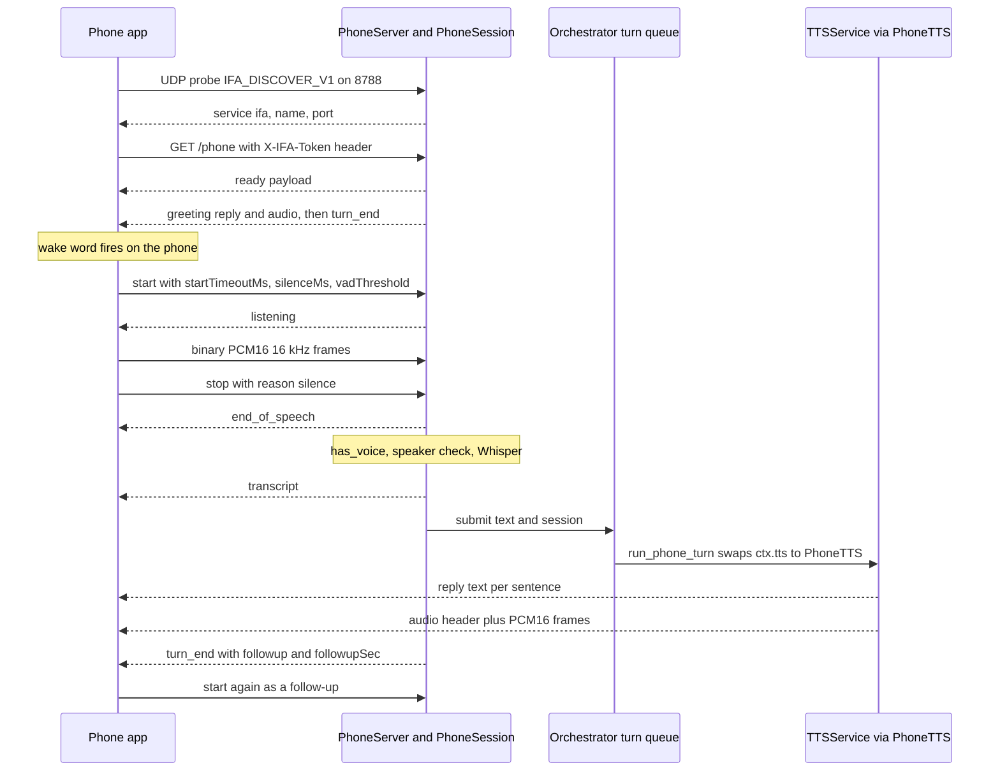

# Phone turn

The Android app (ifaApp) finds the PC on the LAN, opens one WebSocket, and runs the wake word on the phone. The PC does the rest: end-of-speech detection, speaker check, Whisper, the agent, and TTS, which it streams back as PCM16. This flow runs for every phone-originated turn while the phone is connected. It also covers notification nudges, typed text, and voice enrollment.

## Steps

| # | Step | Where (file → function) | Notes |
|---|------|-------------------------|-------|
| 1 | Server starts | [orchestrator.py](../../ifa/core/orchestrator.py) → `run`; [phone_server.py](../../ifa/services/phone_server.py) → `start_phone_server`, `PhoneServer.start` | Skipped when `IFA_PHONE_ENABLED=0`. aiohttp runs on its own thread and event loop (`_serve_http`). Prints the WS URL and pairing code. |
| 2 | PC mic pauses while a phone is connected | [orchestrator.py](../../ifa/core/orchestrator.py) → `run` calls `input_mode.pause_while(phones.has_priority)`; [input.py](../../ifa/voice/input.py) → `VoiceInput._run_loop` | `has_priority` is true when `IFA_PHONE_PRIORITY` is on and at least one session exists. The PC loop keeps reading mic chunks but ignores them. |
| 3 | UDP discovery | ifaApp `ifa/IfaDiscovery.kt` → `discover`; [phone_server.py](../../ifa/services/phone_server.py) → `_serve_discovery`, `discovery_reply` | Phone broadcasts `IFA_DISCOVER_V1` to 255.255.255.255 and the subnet broadcast. PC answers JSON `{service, version, name, port}`. A manual host in app settings skips discovery. |
| 4 | Pairing check | ifaApp `ifa/IfaConnection.kt` → `connect`; [phone_server.py](../../ifa/services/phone_server.py) → `_websocket`, `check_pairing` | Header `X-IFA-Token`. Whitespace is stripped, then a constant-time compare. 5 wrong codes from one IP → HTTP 429 for 60 s. Wrong code → 401. Code comes from [pairing.py](../../ifa/services/pairing.py) → `load_pairing_code`. |
| 5 | Session opens, `ready` sent | [phone_server.py](../../ifa/services/phone_server.py) → `_websocket`, `ready_payload`, `warm_up_in_background` | One `PhoneSession` per socket. All outbound frames go through an asyncio outbox (`_post` → `run_writer`). Whisper warm-up starts on first connect. |
| 6 | Connect greeting | [phone_server.py](../../ifa/services/phone_server.py) → `PhoneSession.greet`; [orchestrator.py](../../ifa/core/orchestrator.py) → `greet_on_pc` | Only for the first session, and only if the PC was "away" at least `IFA_PHONE_GREETING_AFTER_MIN`. Plays on the phone (pre-rendered filler clip if ready) **and** on the PC speakers. Ends with `turn_end` `followup:false`. |
| 7 | Wake word on the phone | ifaApp `service/IfaVoiceService.kt` → `detectWake`, `onWake`, `startListening` | Uses `wakeThreshold`/`wakeConsecutive` from `ready` unless the app overrides the threshold. Plays a cue, then sends `start` with `startTimeoutMs` 8000. |
| 8 | Start capture | [phone_server.py](../../ifa/services/phone_server.py) → `PhoneSession.on_message` (`start`), `_start_listening`, `capture_options` | `woke = not _expect_reply`. Sends `error` `busy` if a turn is running. `silenceMs` clamped 300–5000, `vadThreshold` clamped 0.1–0.95. |
| 9 | Audio streaming | ifaApp `service/IfaVoiceService.kt` → `stream`; [phone_server.py](../../ifa/services/phone_server.py) → `on_audio`, `PcmBuffer` | Binary frames are 16 kHz mono PCM16 LE, already gain-boosted on the phone. Frames arriving outside a capture are dropped. |
| 10 | End of speech | [phone_server.py](../../ifa/services/phone_server.py) → `_capture`, `PhoneServer.capture`; [capture.py](../../ifa/voice/capture.py) → `capture_utterance` | Silero VAD on the PC reads 512-sample chunks. Capture also ends on phone `stop`, `cancel`, a 5 s audio stall, or the start timeout. Phone runs its own endpointer with +500 ms grace and sends `stop` `reason:silence`. |
| 11 | Gate | [phone_server.py](../../ifa/services/phone_server.py) → `_capture`, `has_voice` | Sends `end_of_speech`. Rejects if cancelled, < 0.3 s, or peak < 0.01. Optional WAV dump. Enrollment captures branch off here (see below). |
| 12 | Speaker check | [speaker.py](../../ifa/voice/speaker.py) → `SpeakerCheck.check(audio, "phone", woke=...)` | Off when nothing is enrolled. A short command right after the wake word is accepted without scoring. See [speaker verification](../design/speaker-verification.md). |
| 13 | Whisper | [phone_server.py](../../ifa/services/phone_server.py) → `normalize`, `PhoneServer.transcribe`; [stt.py](../../ifa/voice/stt.py) → `transcribe_array` | Audio is peak-normalised to 0.5 (max 20× gain) first. Empty text → `no_speech`. |
| 14 | Transcript and submit | [phone_server.py](../../ifa/services/phone_server.py) → `_capture`; [orchestrator.py](../../ifa/core/orchestrator.py) → `run` | Sends `transcript`, then `submit(text, session)` puts `(text, phone)` on the shared `turns` queue. Phone and PC turns are serialized by that queue. |
| 15 | Agent turn | [orchestrator.py](../../ifa/core/orchestrator.py) → `run_phone_turn`, `run_turn` | Dismissals end the turn with no reply. Otherwise `ctx.tts` is swapped to `PhoneTTS` for the turn, so fillers and tool speech also go to the phone. Agent internals: [Agent turn](agent-turn.md). |
| 16 | Reply and audio | [orchestrator.py](../../ifa/core/orchestrator.py) → `run_phone_turn.on_sentence`; [phone_server.py](../../ifa/services/phone_server.py) → `PhoneTTS.enqueue`, `send_reply`, `send_audio` | Per sentence: `reply` text, then an `audio` header with `sampleRate`, then binary PCM16 chunks of 4800 samples. Fillers send audio only, no `reply`. |
| 17 | Turn end | [orchestrator.py](../../ifa/core/orchestrator.py) → `run_phone_turn.finish`; [phone_server.py](../../ifa/services/phone_server.py) → `finish_turn` | A thread waits for all TTS events, then sends `turn_end`. `followup` is true unless the agent ended the conversation and `IFA_FOLLOWUP_WINDOW_SEC > 0`. A queued nudge runs instead of `turn_end`. |
| 18 | Follow-up listen | ifaApp `service/IfaVoiceService.kt` → `onPlaybackFinished` | After playback, if `followup`, the app sends `start` with `startTimeoutMs = followupSec*1000` and no wake word. On the PC `_expect_reply` is true, so `woke=false`. |

**Other entry points on the same socket**

- **Nudge** — `NotificationCenter.on_announce` → `route_announcement` → `PhoneServer.nudge(level)` → `PhoneSession.nudge`. It targets the newest session. If busy, it is held in `_pending_nudge` (urgent wins) and runs from `finish_turn`. It sends `nudge`; for `urgent` it also plays the `URGENT_ANNOUNCEMENT` clip. Then it sends `turn_end` with `followup:true`, `followupSec = IFA_NOTIF_LISTEN_SEC`, `cue:true`. If no phone has priority, `nudge` returns false and the PC announces instead. See [Notifications](notifications.md).
- **Text** — `text` → `_start_text` → `submit` directly. No VAD, speaker check, or `transcript` echo.
- **Cancel / stop** — `stop` closes the audio buffer, so capture ends and what was heard is processed. `cancel` also sets `_cancelled`, so the capture is dropped as `no_speech` `cancelled`.
- **Enrollment** — `enroll_begin` (downloads the speaker model, replies `enroll_ready` with phrases) → per phrase a `start` with `enroll:true` → `enroll_sample` → `enroll_finish` → `enroll_done`. `enroll_forget` wipes all sources. `enroll_cancel` drops samples.
- **Phone notifications** — `notification` forwards the Android notification to `NotificationCenter`; `notification_settings` tunes the inbox and `listenSec`.

> [!WARNING]
> `cancel` does not stop the agent or TTS on the PC. It only affects a capture or transcription in progress. During THINKING/SPEAKING the app stops its player and ignores audio until the next `turn_end`, but the PC still finishes the turn.

## Message reference

| Type | Dir | Fields | Meaning |
|------|-----|--------|---------|
| `ready` | PC→phone | `version`, `name`, `ttsSampleRate`, `wakeThreshold`, `wakeConsecutive`, `followupSec`, `voiceSources` | Sent once after pairing succeeds. |
| `start` | phone→PC | `startTimeoutMs`, `silenceMs`, `vadThreshold`, `enroll` | Begin a capture. |
| (binary) | phone→PC | PCM16 LE, 16 kHz mono | Mic audio; kept only while capturing. |
| `stop` | phone→PC | `reason` (`silence`, `button`) | End capture now; keep the audio. |
| `cancel` | phone→PC | — | End capture and discard it. |
| `text` | phone→PC | `text` | Typed message; becomes a turn. |
| `notification` | phone→PC | `packageName`, `appName`, `title`, `text`, `receivedAt`, `priority`, `appNote` | Forward an Android notification. |
| `notification_settings` | both | phone: inbox settings and `listenSec`; PC echo: applied values | Configure the notification inbox. |
| `enroll_begin` / `enroll_finish` / `enroll_cancel` / `enroll_forget` | phone→PC | — | Voice enrollment control. |
| `ping` | phone→PC | — | PC answers `pong`. The app relies on WS-level pings instead. |
| `listening` | PC→phone | — | Capture started. |
| `end_of_speech` | PC→phone | — | Capture ended; phone stops streaming and shows THINKING. |
| `no_speech` | PC→phone | `reason` | Rejected or empty capture; followed by `turn_end`. |
| `transcript` | PC→phone | `text` | What Whisper heard. |
| `reply` | PC→phone | `text` | One spoken sentence (or the greeting). |
| `audio` | PC→phone | `sampleRate` | Header; binary PCM16 frames follow. |
| `turn_end` | PC→phone | `followup`, `followupSec`, `cue` (nudges only) | Turn over; listen again if `followup`. |
| `nudge` | PC→phone | `level` (`normal`/`urgent`) | A notification is waiting. |
| `enroll_ready` / `enroll_sample` / `enroll_done` | PC→phone | `phrases` / `ok`, `count`, `seconds`, `message` / `ok`, `message`, `sources` | Enrollment progress. |
| `error` | PC→phone | `message` | `busy`, bad JSON, unknown type, turn failure. |

## Where it can fail

| Symptom | Log line to look for | Likely cause | Fix / setting |
|---------|---------------------|--------------|---------------|
| App stuck "Looking for your PC" | `[phone] discovery unavailable (…); set the PC address in the app instead` | UDP 8788 in use, firewall, or client isolation on Wi-Fi | Enter the PC IP in the app; open UDP `IFA_PHONE_DISCOVERY_PORT` |
| Phone server missing | `[phone] could not start the phone server: …` or `[phone] phone app connection disabled (IFA_PHONE_ENABLED=0)` | Port 8789 taken, aiohttp missing, or disabled | `IFA_PHONE_PORT`, `IFA_PHONE_ENABLED` |
| App says wrong pairing code | `[phone] <ip> sent a wrong pairing code (N characters). The code is …` | Code in app differs from `.phone_token` / `IFA_PHONE_TOKEN` | Copy the printed code into the app |
| App locked out for a minute | (HTTP 429, no PC log line) | 5 wrong codes from that IP | Wait 60 s; fix the code |
| Wake fires, nothing happens | `[phone] no speech: nothing loud enough to be speech (peak …, ended by …)` | Quiet mic or VAD never triggered | App mic boost; `vadThreshold` in app settings |
| Long silence then nothing | `ended by phone audio stalled` in `[phone] captured …` | Wi-Fi dropped frames for 5 s | Check Wi-Fi; app holds a low-latency Wi-Fi lock |
| Speech ignored | `[phone] no speech: ignored, not your voice …` or `… too short to tell whose voice it is …` | Speaker check rejected it | Re-enroll on the phone; `IFA_SPEAKER_THRESHOLD`, `IFA_SPEAKER_CHECK=0` |
| Heard but empty | `[phone] no speech: speech-to-text found no words in …` | Whisper returned nothing | `IFA_WHISPER_MODEL`, `IFA_WHISPER_PROMPT`; dump with `IFA_VOICE_DEBUG_WAV` |
| "Ifa is still finishing the last reply" in app | (PC sends `error` `busy`) | `start`/`text` while a turn or nudge is in flight | Wait for `turn_end` |
| Error reply on phone | `[phone] turn failed: …` | Exception in the agent turn | See [Agent turn](agent-turn.md) |
| Phone keeps dropping | `[phone] disconnected: <ip> after Ns (close code C…)` | Code 1000/1001: the app closed it (reconnect button, app stopped). Code 1006 or an error: the phone vanished: Wi-Fi drop or power saving, the app killed in the background, or its 10 s ping got no answer | Check the app's Logs tab for `Ifa disconnected: <reason>` |
| Reply finishes on the PC speakers | `[phone] disconnected: <ip>` mid-reply | `PhoneTTS._sink` returns no sink once the session is closed, so `TTSService` plays locally | Expected fallback |
| Urgent nudge silent | `[phone] couldn't play the announcement: …` | TTS error | Check TTS logs |
| No greeting | `[phone] couldn't play the greeting: …` / `… on the PC: …` | TTS error, or reconnect sooner than `IFA_PHONE_GREETING_AFTER_MIN` | Set the minutes to 0 or blank `IFA_PHONE_GREETING` |
| First reply slow | `[phone] speech-to-text warm-up failed: …` | Whisper load failed in warm-up | `IFA_WHISPER_DEVICE` |

## Settings

| Env var | Launcher label | Default | Effect |
|---------|----------------|---------|--------|
| `IFA_PHONE_ENABLED` | Phone app connection | `1` | Start the phone server at all. |
| `IFA_PHONE_PRIORITY` | Phone takes over when connected | `1` | Pause the PC mic and route nudges to the phone while connected. |
| `IFA_PHONE_PORT` | Phone app port | `8789` | WebSocket port (`/phone`, `/phone/health`). |
| `IFA_PHONE_DISCOVERY_PORT` | Phone discovery port | `8788` | UDP discovery port. The app hard-codes 8788. |
| `IFA_PHONE_HOST` | (not in launcher) | `0.0.0.0` | Bind address. |
| `IFA_PHONE_TOKEN` | Phone pairing code | blank | Fixed code; blank uses or creates a random 6-digit `.phone_token`. |
| `IFA_PHONE_GREETING` | Greeting when the phone connects | `Hello sir, I am live, welcome home` | Blank disables the greeting. |
| `IFA_PHONE_GREETING_AFTER_MIN` | Greet only after being away (min) | `0` | Minimum time since the last phone disconnect before greeting again. |
| `IFA_FOLLOWUP_WINDOW_SEC` | Follow-up window (s) | `5` | `followupSec` in `ready`/`turn_end`; `0` disables follow-up. |
| `IFA_NOTIF_LISTEN_SEC` | (not in launcher) | `8` | Listen window after a nudge. The phone can override it via `listenSec`. |
| `IFA_WAKE_THRESHOLD` / `IFA_WAKE_CONSECUTIVE` | Wake word threshold / Wake frames required | `0.7` / `2` | Sent in `ready` as the phone's wake defaults. |
| `IFA_VAD_SILENCE_MS`, `IFA_VAD_THRESHOLD`, `IFA_VAD_MAX_UTTERANCE_MS` | End-of-speech silence / Speech detection threshold / Max utterance | `1500` / `0.5` / `30000` | PC VAD defaults. The phone's `silenceMs` and `vadThreshold` override the first two. |
| `IFA_SPEAKER_CHECK`, `IFA_SPEAKER_THRESHOLD`, `IFA_SPEAKER_SHORT_THRESHOLD`, `IFA_SPEAKER_TRUST_SEC` | Only listen to my voice / Voice match threshold / … short replies / Trust short replies for (s) | `1` / `0.5` / `0.40` / `90` | Speaker gate; trust is tracked per source (`phone`). |
| `IFA_WHISPER_MODEL`, `IFA_WHISPER_LANGUAGE`, `IFA_WHISPER_PROMPT`, `IFA_WHISPER_DEVICE` | Whisper model / language token / Words to recognise / Speech-to-text device | see [speech pipeline](../design/speech-pipeline.md) | STT used for phone audio. |
| `IFA_VOICE_DEBUG_WAV` | Debug audio folder | blank | Dumps each phone capture as `ifa_phone_<ms>.wav`. |

> [!NOTE]
> `IFA_NOTIF_LISTEN_SEC` and `IFA_PHONE_HOST` are read in code but have no row in `launcher/settings_schema.py`.

## Patterns

- **Thin client, fat server.** The phone only does the wake word, gain, and a rough endpointer. VAD, STT, the agent and TTS stay on the PC, so models live in one place and the app stays simple.
- **Single turn queue (serialized actor).** Phone turns and PC turns go through one `queue.Queue` in `run`. Only one agent turn runs at a time, so shared state like `ctx` and memory needs no locks.
- **Sink injection / adapter.** `PhoneTTS` wraps `TTSService` and adds a `sink` that sends audio over the socket. Swapping `ctx.tts` for one turn reroutes every speaker (fillers, tools, replies) without the agent knowing.
- **Thread-to-async bridge.** Worker threads never touch the socket. They post to an asyncio outbox with `call_soon_threadsafe`, and one writer coroutine sends frames in order.
- **Implicit state from protocol context.** The PC infers "woke" from whether it just asked for a reply (`_expect_reply`), so the protocol needs no extra flag.

## Related

- [Agent turn](agent-turn.md)
- [PC voice turn](voice-turn-pc.md)
- [Notifications](notifications.md)
- [Startup](startup.md)
- [Launcher](launcher.md)
- [Phone app design](../design/phone-app.md)
- [Speaker verification](../design/speaker-verification.md)
- [Speech pipeline](../design/speech-pipeline.md)
- [Notifications design](../design/notifications.md)
