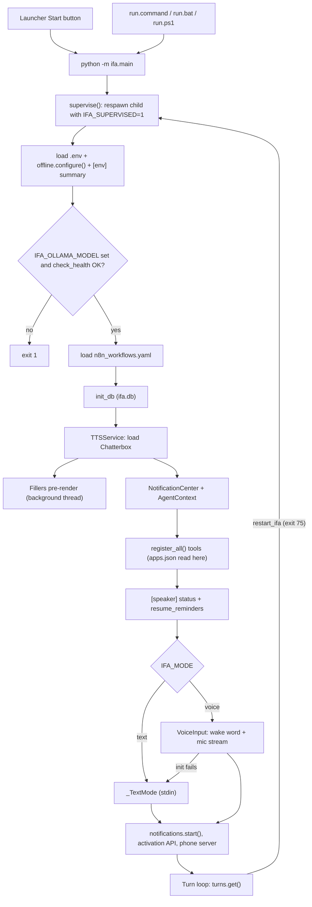

# Startup

What happens from "start Ifa" until she is listening. A launcher or run script spawns `python -m ifa.main`, which loads `.env`, picks online or offline model loading, then `orchestrator.run()` checks Ollama, loads the voice, wires services and enters the turn loop.

## Steps

| # | Step | Where (file → function) | Notes |
|---|------|-------------------------|-------|
| 1a | Launcher Start | [server.py](../../launcher/server.py) → `Launcher.start_agent`; [agent_process.py](../../launcher/agent_process.py) → `AgentProcess.start` | Runs `<venv python> -u -m ifa.main` with cwd = repo root. Refuses while Setup is running. Strips every settings key and every `.env` key from the inherited env (`clear_env`), so the child reads `.env` fresh. Sets `PYTHONUNBUFFERED`, `PYTHONIOENCODING=utf-8`, `PYTHONPATH`. stdout/stderr go to the launcher log; stdin is a pipe, which is how the launcher console sends text turns. |
| 1b | Run scripts | [run.command](../../run.command), [run.bat](../../run.bat), [run.ps1](../../run.ps1) (+ `run-ps.bat`), [run-voice.command](../../run-voice.command), [run-voice.bat](../../run-voice.bat) | Self-heal: create venv, install packages, start `ollama serve` (15 s wait), pull `IFA_OLLAMA_MODEL` from `.env`, then `python -m ifa.main`. `run.command` and `run.ps1` also run `scripts.setup_voice_models`; `run.bat` does not. `run-voice.*` just set `IFA_MODE=voice` and delegate. |
| 2 | Supervisor | [supervisor.py](../../ifa/supervisor.py) → `supervise` | The first process does nothing but loop: spawn `python -m ifa.main` with `IFA_SUPERVISED=1`, wait, and respawn if the exit code is `75` (`RESTART_EXIT_CODE`). Any other code ends it. |
| 3 | Load `.env` | [main.py](../../ifa/main.py) → module top level | `load_dotenv(<repo>/.env, override=False)`. Real env vars win over `.env`. Runs in the child only, so each restart re-reads `.env`. |
| 4 | Offline mode | [offline.py](../../ifa/utils/offline.py) → `configure` | `IFA_OFFLINE` on/off forces it. `auto` checks the HF cache for Whisper (`IFA_WHISPER_MODEL`) and `ResembleAI/chatterbox-turbo`; offline only if both have a snapshot with a `.json` and weights. Sets `HF_HUB_OFFLINE` and `TRANSFORMERS_OFFLINE` to `1`/`0`. |
| 5 | Env printout | [main.py](../../ifa/main.py) → `_log_env_summary` | Prints `[env] loaded …`, the offline status, then every `IFA_*`, `HF_HUB_OFFLINE`, `HF_TOKEN`, `PYTHONPATH`. `HF_TOKEN` shows first and last 4 chars only. |
| 6 | Import orchestrator | [settings.py](../../ifa/config/settings.py) | `IFA_OLLAMA_MODEL`, `MAIN_OLLAMA_URL`, think, ctx, keep-alive are read at import time. Importing `tts_service` also imports torch and Chatterbox (slow, eager). |
| 7 | Model check | [orchestrator.py](../../ifa/core/orchestrator.py) → `run`; [ollama_client.py](../../ifa/services/ollama_client.py) → `check_health` | Exit 1 if model unset. `check_health` GETs `/api/tags`, checks a name starts with the model, then sends a real chat with a probe tool (30 s timeout). That proves tool calling works and loads the model into Ollama. |
| 8 | n8n workflows | [n8n.py](../../ifa/tools/n8n.py) → `load_n8n_config` | Reads `ifa/config/n8n_workflows.yaml`. Missing file = no workflows. Bad YAML = exit 1. |
| 9 | Database | [db.py](../../ifa/services/db.py) → `init_db` | `ifa.db` (relative to cwd), WAL mode. Creates `reminders` and `memories`. Imports `memory.md` once if present. `notification_history` is created later by `NotificationHistory.__init__`. |
| 10 | TTS | [tts_service.py](../../ifa/services/tts_service.py) → `TTSService.__init__`; [devices.py](../../ifa/utils/devices.py) → `resolve_device` | Loads Chatterbox Turbo eagerly on `IFA_TTS_DEVICE` (auto = CUDA if available). Starts producer and player threads. Voice clone file `IFA_VOICE_SAMPLE`. |
| 11 | Speech queue + executor | [speech_queue.py](../../ifa/utils/speech_queue.py) → `SpeechQueue` | Sentence queue feeding `tts.enqueue`. One-worker `ThreadPoolExecutor` runs agent turns. |
| 12 | Fillers | [fillers.py](../../ifa/services/fillers.py) → `Fillers.prepare_in_background` | Background thread renders: urgent announcement, greeting (`IFA_PHONE_GREETING`), generic phrases (`IFA_FILLER_PHRASES` or built-in), per-tool phrases. Until a clip is ready, callers fall back to live TTS or skip the filler. |
| 13 | Notifications | [notifications.py](../../ifa/services/notifications.py) → `NotificationCenter`, `NotificationInbox`; [notification_history.py](../../ifa/services/notification_history.py) | Classifier and summarizer use the same Ollama model. Thread starts later in step 18. |
| 14 | Agent context | [context.py](../../ifa/core/context.py) → `AgentContext` | Holds TTS, db path, n8n config, contacts (hard-coded `CONTACTS`), notifications. |
| 15 | Tools | [tools/\_\_init\_\_.py](../../ifa/tools/__init__.py) → `register_all`; [system.py](../../ifa/tools/system.py) → `build_tool`; [custom_apps.py](../../ifa/services/custom_apps.py) → `load` | Each module gives `build_tool()` or `TOOL`; `None` skips it. `system.build_tool` reads `apps.json` once here. Also registers recall, forget, end-conversation, restart. |
| 16 | Speaker status | [speaker.py](../../ifa/voice/speaker.py) → `shared`, `SpeakerCheck.status` | Reads the voice profile; prints one `[speaker] …` line. The embedding model itself is not run yet. |
| 17 | Reminders | [orchestrator.py](../../ifa/core/orchestrator.py) → `resume_reminders` | One sleeping thread per row in `reminders`. Overdue ones fire at once. |
| 18 | Input mode | [input.py](../../ifa/voice/input.py) → `init_input` | `IFA_MODE` not `voice` → `_TextMode` (stdin). `voice` → `VoiceInput`: loads the openWakeWord model, opens a 16 kHz mic stream, starts the voice loop thread. Any error falls back to text mode. Whisper is NOT loaded here (see below). Then `notifications.start()`, `VibeManager`, `Memory()`. |
| 19 | Activation API | [activation_server.py](../../ifa/services/activation_server.py) → `start_activation_server` | Unless `IFA_API_ENABLED` is off: HTTP server on `IFA_API_HOST:IFA_API_PORT` for `POST /activate`. |
| 20 | Local input pump | [orchestrator.py](../../ifa/core/orchestrator.py) → `pump_local_input` | Thread that pushes `input_mode.get()` into the `turns` queue. |
| 21 | Phone server | [phone_server.py](../../ifa/services/phone_server.py) → `start_phone_server`, `PhoneServer.start`; [pairing.py](../../ifa/services/pairing.py) → `load_pairing_code` | WebSocket on `IFA_PHONE_PORT`, UDP discovery on `IFA_PHONE_DISCOVERY_PORT`. Pairing code from `IFA_PHONE_TOKEN`, else `.phone_token`, else a new 6-digit code. If priority is on, the PC mic pauses while a phone is connected. |
| 22 | Turn loop | [orchestrator.py](../../ifa/core/orchestrator.py) → `run` (while loop) | Blocks on `turns.get()`. Phone turns go to `run_phone_turn`, local ones to `run_turn`. `exit`/`quit` ends; `restart_ifa` exits with 75. |

> [!NOTE]
> Lazy vs eager. Eager: torch + Chatterbox, the Ollama model (via the probe chat), wake word model, mic stream, `apps.json`, n8n YAML. Lazy: Whisper loads on the first transcription (`stt._get_model`), or in the background when a phone connects (`warm_up_in_background`). In PC voice mode the first spoken turn pays the Whisper load. The speaker embedder also runs only on first use.

## Where it can fail

| Symptom | Log line to look for | Likely cause | Fix / setting |
|---|---|---|---|
| Exits right after `Orchestrator running...` | `❌ IFA_OLLAMA_MODEL is not set. Add it to .env…` | No model in env or `.env` | Set `IFA_OLLAMA_MODEL` |
| Exits, Ollama not up | `❌ Ollama is not running at …` | `ollama serve` not running, wrong URL | Start Ollama; check `MAIN_OLLAMA_URL` |
| Exits, model missing | ``❌ Model `…` is not pulled in Ollama.`` | Model not pulled, or name typo | `ollama pull <model>` |
| Exits on probe | `❌ Ollama accepted a connection but rejected a tool-calling request…` / `❌ Ollama tool-calling conformance probe failed…` | Old Ollama, model without tools, or load took >30 s | Upgrade Ollama; pick a tool-capable model |
| Exits on n8n | `❌ n8n config at … has a YAML syntax error` | Bad `n8n_workflows.yaml` | Fix or delete the file |
| Models try to download / fail offline | `[env] online (not downloaded yet: …)` | Cache incomplete | Launcher Setup, Download voice models; or `IFA_OFFLINE` |
| Wrong device | `[device] IFA_TTS_DEVICE=cuda but no CUDA GPU is available; using cpu` | No CUDA build/GPU | `IFA_TTS_DEVICE`, `IFA_WHISPER_DEVICE` |
| No watermark warning | `[tts] Chatterbox's audio watermark couldn't load…` | setuptools too new | Harmless; Setup, Install packages |
| A filler never plays | `[fillers] could not render '…'` | TTS error for that phrase | Check the phrase / voice sample |
| Voice silently becomes text | `[voice] mode=voice failed to init (…); falling back to text mode for this session.` | No mic, missing openwakeword, bad wake model | Fix the cause, restart |
| Wake word changed | `[wake_word] WARNING: wake-word model not found at …` | `IFA_WAKE_MODEL` path missing | Restore file or re-run setup |
| Custom app missing | `[apps] ignoring apps.json: …` / `[apps] skipping entry N in apps.json: …` | Bad JSON or entry | Fix in launcher Apps tab |
| Voice check off | `[speaker] voice check OFF: …` / `[speaker] voice check off: no voice enrolled yet…` | sherpa-onnx or model missing, no enrollment | Setup; enroll voice; `IFA_SPEAKER_CHECK` |
| Phone can't connect | `[phone] could not start the phone server: …` | Port 8789 taken | `IFA_PHONE_PORT` |
| Crash with a traceback after `[voice] …` | `OSError` (address in use), no `[api] listening` line | Port 8787 taken; not caught | `IFA_API_PORT` or `IFA_API_ENABLED=0` |

## Settings

| Variable | Default | Effect at startup |
|---|---|---|
| `IFA_OLLAMA_MODEL` | (none, required) | Model checked and used for everything |
| `MAIN_OLLAMA_URL` | `http://localhost:11434` | Ollama server for the health check |
| `IFA_OLLAMA_THINK`, `IFA_OLLAMA_NUM_CTX`, `IFA_OLLAMA_KEEP_ALIVE` | `0`, `8192`, `10m` | Read at import, used by every chat |
| `IFA_OFFLINE` | `auto` | Sets `HF_HUB_OFFLINE` / `TRANSFORMERS_OFFLINE` |
| `IFA_MODE` | `text` | text (stdin) or voice (wake word + mic) |
| `IFA_TTS_DEVICE` / `IFA_WHISPER_DEVICE` | `auto` | cuda or cpu for Chatterbox / Whisper |
| `IFA_VOICE_SAMPLE` | `ifa/audios/voice.wav` | Voice clone source |
| `IFA_WAKE_MODEL`, `IFA_WAKE_THRESHOLD`, `IFA_WAKE_CONSECUTIVE` | `ifa/models/ifa.onnx`, `0.7`, `2` | Wake word listener |
| `IFA_WHISPER_MODEL` | `Oriserve/Whisper-Hindi2Hinglish-Apex` | Also part of the offline cache check |
| `IFA_FILLER_PHRASES`, `IFA_FILLER_DELAY_MS` | built-in list, `650` | Pre-rendered fillers, filler timing |
| `IFA_SPEAKER_CHECK` | `1` | Speaker status line and gating |
| `IFA_API_ENABLED`, `IFA_API_HOST`, `IFA_API_PORT`, `IFA_API_TOKEN` | `1`, `127.0.0.1`, `8787`, empty | Activation HTTP server |
| `IFA_PHONE_ENABLED`, `IFA_PHONE_PORT`, `IFA_PHONE_DISCOVERY_PORT`, `IFA_PHONE_TOKEN`, `IFA_PHONE_PRIORITY` | `1`, `8789`, `8788`, empty, `1` | Phone server |
| `IFA_PHONE_GREETING` | `Hello sir, I am live, welcome home` | Pre-rendered greeting text |
| `IFA_NOTIF_HISTORY_DAYS` | `30` | History retention |
| `HF_TOKEN` | empty | Only for downloads; masked in `[env]` |

## What needs a restart

| Thing | Why |
|---|---|
| Any `.env` value | Read once by `load_dotenv` and module-level constants |
| `apps.json` | Read once in `system.build_tool` |
| Greeting and filler phrases | Rendered once at startup |
| `n8n_workflows.yaml` | Loaded once into `AgentContext` |
| Input mode, wake model, devices | Chosen once in `init_input` / `TTSService` |

> [!TIP]
> Say "restart yourself" (the `restart_ifa` tool). The child exits with 75, the supervisor respawns it, and the new child re-reads `.env` and `apps.json`. The launcher Stop/Start does the same.

## Patterns

- **Fail-fast health check.** Missing model, dead Ollama or no tool support stop startup with one clear `❌` line, instead of failing on the first user turn. The probe chat also warms the model in Ollama.
- **Warm-up / pre-render.** Fillers, the urgent line and the greeting are synthesized in a background thread so they play instantly later, without delaying boot.
- **Lazy loading.** Whisper and the speaker embedder load on first use, which keeps startup and RAM lower; the cost moves to the first voice turn.
- **Graceful degradation.** Voice init failure falls back to text mode; a missing wake model falls back to a built-in; phone server failure returns `None`; a missing voice profile means "listen to everyone".
- **Supervisor process.** A tiny parent restarts the real process on a known exit code, so "restart" is just `os._exit(75)` and gives a clean reload.

## Related

- [Agent turn](agent-turn.md)
- [PC voice turn](voice-turn-pc.md)
- [Phone turn](phone-turn.md)
- [Notifications](notifications.md)
- [Launcher](launcher.md)
- [Launcher and setup design](../design/launcher-and-setup.md)
- [Speech pipeline design](../design/speech-pipeline.md)
- [Agent loop design](../design/agent-loop.md)
- [Architecture](../ARCHITECTURE.md)
