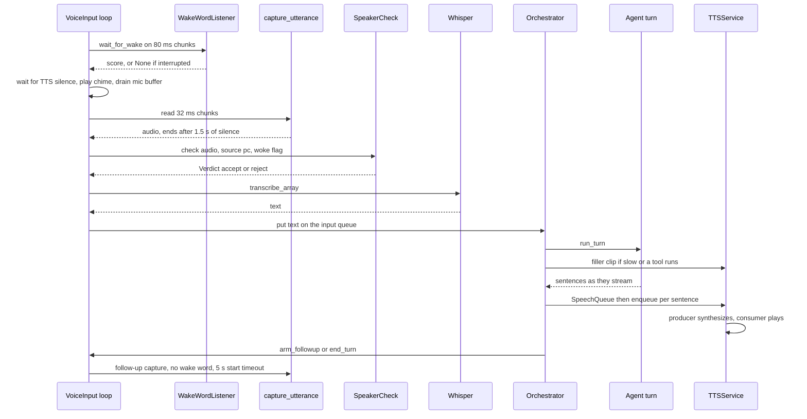

# PC voice turn

One spoken exchange through the PC microphone: Ifa waits for the wake word, records you until you stop talking, checks it is your voice, turns the audio into text, and hands the text to the orchestrator. The reply is spoken sentence by sentence, and then Ifa listens for a few seconds without needing the wake word again. It runs only when `IFA_MODE=voice`.

## Steps

| # | Step | Where (file → function) | Notes |
|---|---|---|---|
| 1 | Pick input mode | [input.py](../../ifa/voice/input.py) → `init_input` | `IFA_MODE=voice` builds `VoiceInput` and starts the `ifa-voice-loop` thread. Any init error falls back to text mode for the session. |
| 2 | Open the mic | [input.py](../../ifa/voice/input.py) → `VoiceInput.__init__` | One `sounddevice.InputStream`, 16 kHz mono float32, open for the whole session. Wake word and capture read from the same stream. |
| 3 | Wait for the previous turn | [input.py](../../ifa/voice/input.py) → `VoiceInput._run_loop` | After a transcript is queued, the loop blocks on the `_turn_complete` event until the orchestrator calls `arm_followup` or `end_turn`. |
| 4 | Phone pause check | [input.py](../../ifa/voice/input.py) → `_run_loop`; [phone_server.py](../../ifa/services/phone_server.py) → `has_priority` | While a phone is connected and `IFA_PHONE_PRIORITY` is on, the loop keeps reading and discarding wake-size chunks so the stream doesn't back up. |
| 5 | Choose how to listen | [input.py](../../ifa/voice/input.py) → `_run_loop` | Order: a held notification first (`take_announcement`), then follow-up window, otherwise wake word. |
| 6 | Wake word | [wake_word.py](../../ifa/voice/wake_word.py) → `WakeWordListener.wait_for_wake` | openWakeWord on 1280-sample (80 ms) chunks. Needs `IFA_WAKE_CONSECUTIVE` chunks in a row at or above `IFA_WAKE_THRESHOLD`. While TTS is speaking it feeds silence instead, so Ifa can't wake herself. Returns `None` if `interrupt()` is true (notification waiting or phone connected). |
| 7 | Notification instead of wake | [input.py](../../ifa/voice/input.py) → `_run_loop`; [orchestrator.py](../../ifa/core/orchestrator.py) → `announce_urgent` | Urgent: plays "Sir, there is an urgent message for you." and waits for it. Normal: no spoken line, only the chime. Then listens up to `IFA_NOTIF_LISTEN_SEC` for you to start talking. See [Notifications](notifications.md). |
| 8 | Chime and drain | [input.py](../../ifa/voice/input.py) → `_wait_for_tts_silence`, `_drain_stream`; [cues.py](../../ifa/voice/cues.py) → `play_listening_cue` | Waits until `tts.is_speaking` is false (includes the echo cooldown). Plays `ifa/audios/wakesound.wav` (blocking). Then throws away everything buffered in the mic stream, including the chime. No chime in the follow-up window. |
| 9 | Capture with VAD | [capture.py](../../ifa/voice/capture.py) → `capture_utterance` | Silero VAD (from faster-whisper's assets) scores each 512-sample (32 ms) chunk. Ends after `IFA_VAD_SILENCE_MS` of silence once speech was seen, or at `IFA_VAD_MAX_UTTERANCE_MS`. With a start timeout and no speech, returns empty audio. If VAD throws, it switches to an RMS energy estimate. |
| 10 | Latency timer | [input.py](../../ifa/voice/input.py) → `_run_loop`; [latency.py](../../ifa/utils/latency.py) → `begin` | Starts a "voice" `TurnTimer` back-dated by the silence wait. `run_turn` later claims it via `claim_or_begin`. |
| 11 | Voice check | [speaker.py](../../ifa/voice/speaker.py) → `SpeakerCheck.check` | Skipped (accept) when off, nothing enrolled, or sherpa-onnx/model missing. See the rules below the table. Skipped entirely if the audio is empty. |
| 12 | Speech-to-text | [stt.py](../../ifa/voice/stt.py) → `transcribe_array` | Hugging Face Whisper (default `Oriserve/Whisper-Hindi2Hinglish-Apex`), loaded lazily on first use under an `RLock`. Language token from `IFA_WHISPER_LANGUAGE`, optional `IFA_WHISPER_PROMPT`. Errors return `""`. |
| 13 | Queue the text | [input.py](../../ifa/voice/input.py) → `_run_loop`, `get`; [orchestrator.py](../../ifa/core/orchestrator.py) → `pump_local_input` | Non-empty text goes on `VoiceInput._queue`. A pump thread moves it to the orchestrator's `turns` queue as `(text, None)`. Phone turns share the same queue. |
| 14 | Turn dispatch | [orchestrator.py](../../ifa/core/orchestrator.py) → `run` | `exit`/`quit` stops the loop. A dismissal ("thanks", "bas", ...) from [dismiss.py](../../ifa/core/dismiss.py) → `is_dismissal` ends the conversation with `end_turn`, without calling the model. |
| 15 | Agent turn | [orchestrator.py](../../ifa/core/orchestrator.py) → `run_turn` | Runs `agent_turn_stream` on a 1-worker executor. Details in [Agent turn](agent-turn.md). |
| 16 | Filler | [orchestrator.py](../../ifa/core/orchestrator.py) → `run_turn.play_filler`; [fillers.py](../../ifa/services/fillers.py) → `Fillers.choose` | At most one per turn, never after the answer started. Fires when the agent calls tools (per-tool phrase, e.g. "Opening that.") or after `IFA_FILLER_DELAY_MS` with no sentence. Clips are pre-rendered at startup by `prepare_in_background`; an unrendered phrase is skipped. |
| 17 | Sentences to TTS | [orchestrator.py](../../ifa/core/orchestrator.py) → `on_sentence`; [speech_queue.py](../../ifa/utils/speech_queue.py) → `SpeechQueue` | Each streamed sentence prints `Ifa: …` and goes through `SpeechQueue` to `TTSService.enqueue`. |
| 18 | Synthesize and play | [tts_service.py](../../ifa/services/tts_service.py) → `_produce_audio`, `_play_audio` | Producer thread splits text with blingfire and runs Chatterbox Turbo per sentence (voice cloned from `IFA_VOICE_SAMPLE`). Consumer thread writes to one `sd.OutputStream`. After each item, `_mute_until` is pushed out by `IFA_TTS_COOLDOWN_MS`. |
| 19 | Follow-up or end | [orchestrator.py](../../ifa/core/orchestrator.py) → `run`; [input.py](../../ifa/voice/input.py) → `arm_followup`, `end_turn` | If the agent set `end_conversation`, `end_turn`; else `arm_followup`. Both release the voice loop (step 3). |
| 20 | Follow-up capture | [input.py](../../ifa/voice/input.py) → `_run_loop` | Waits for TTS silence, no chime, then captures with a start timeout of `IFA_FOLLOWUP_WINDOW_SEC`. No speech in time gives empty audio, then back to the wake word. `woke` is false here. |

**Voice check rules** (`SpeakerCheck.check`). "Voiced" is seconds of 30 ms frames above an RMS floor (`voiced_seconds`), not the clip length.

- `woke` (just after the wake word) and under 2 s voiced: accept as a short command, and refresh trust.
- Under 0.5 s voiced: accept only inside the trust window, else reject "too short".
- Otherwise score the clip against each enrolled centroid (PC and phone), keep the best. Needed: `IFA_SPEAKER_THRESHOLD` for 2 s or more, `IFA_SPEAKER_SHORT_THRESHOLD` for shorter.
- Pass: accept and refresh trust. Fail but under 2 s and inside the trust window: accept as a short reply. Else reject "not your voice".
- Trust is per source (`pc`, `phone`) and lasts `IFA_SPEAKER_TRUST_SEC`. If scoring throws, it lets the audio through.

> [!NOTE]
> Follow-up replies and notification replies are never `woke`, so a short "yes" there depends on the trust window or the short threshold.

> [!WARNING]
> `arm_followup` is called when the agent finishes generating, not when audio finishes. This still works because the loop checks the window right away and the capture's own start timeout only begins after `_wait_for_tts_silence` returns.

## Where it can fail

| Symptom | Log line to look for | Likely cause | Fix / setting |
|---|---|---|---|
| Typing prompt instead of voice | `[voice] mode=text  (set IFA_MODE=voice to use wake-word input)` | Mode not set | `IFA_MODE=voice` |
| Voice mode silently became text | `[voice] mode=voice failed to init (…); falling back to text mode for this session.` | No mic, openwakeword missing, wake model failed to load | Check the error text; reinstall packages; check `IFA_WAKE_MODEL` |
| Wakes on the wrong word | `[wake_word] WARNING: wake-word model not found at …` | `ifa.onnx` missing, fell back to a built-in | Restore `ifa/models/ifa.onnx` or fix `IFA_WAKE_MODEL` |
| Never wakes | Stuck on `[voice] waiting for wake word...` | Threshold too high, or mic is wrong device | Lower `IFA_WAKE_THRESHOLD` or `IFA_WAKE_CONSECUTIVE` |
| No chime | `[voice] listening cue unavailable: …` | `wakesound.wav` missing or not 16-bit PCM | Replace the WAV, or `IFA_LISTENING_CUE=0` |
| Cut off mid-sentence | `[voice] captured …s (peak=… rms=…) — transcribing...` with short duration | Pause longer than the silence window | Raise `IFA_VAD_SILENCE_MS` |
| Your voice rejected | `[voice] ignored: not your voice (score …, needs …)` | Threshold too high, or enrolled in a different room/mic | Lower `IFA_SPEAKER_THRESHOLD`; re-enroll on the PC |
| Short reply rejected | `[voice] ignored: too short to tell whose voice it is (…s of speech)` | Under 0.5 s voiced, outside the trust window | Raise `IFA_SPEAKER_TRUST_SEC`, or say a longer reply |
| Everyone is accepted | `[speaker] voice check OFF: …` at startup | sherpa-onnx or the speaker model missing | Launcher: Setup, Install packages / Download voice models |
| Enrollment ignored | `[speaker] voiceprint.json was made with another model; enroll your voice again` | Model name changed | Enroll again |
| Check crashed | `[speaker] check failed, letting it through: …` | Embedder error | Read the error; audio is accepted meanwhile |
| Nothing happens after speaking | `[whisper] transcription failed: …` then `[voice] (no speech detected / empty transcript)` | Model download/load or device error | Check `IFA_WHISPER_MODEL`, `IFA_WHISPER_DEVICE` |
| Slow first PC turn | `[whisper] loading … on …` on the first turn | Whisper loads lazily | Expected once per run (a phone connection also warms it) |
| Whisper on CPU unexpectedly | `[device] IFA_WHISPER_DEVICE=cuda but no CUDA GPU is available; using cpu` | No CUDA torch | Install CUDA torch, or pick a smaller model |
| Loop hiccup | `[voice] loop error: …` | Exception anywhere from wake to STT | The loop continues; read the error |
| Reply text prints but no sound | `Producer error: …` or `[SpeechQueue] worker error: …` | Chatterbox failed on a sentence | Check `IFA_VOICE_SAMPLE`, `IFA_TTS_DEVICE` |
| No filler plays | `[fillers] could not render '…': …` | Clip failed at startup | Check TTS; fillers are skipped, not fatal |
| Ifa answers herself | Repeated `[voice] heard:` with her own words | Echo after playback | Raise `IFA_TTS_COOLDOWN_MS` |
| PC mic deaf | `[voice] phone connected: PC mic paused` | Phone is connected and has priority | Disconnect the phone, or `IFA_PHONE_PRIORITY=0` |

> [!TIP]
> Set `IFA_VOICE_DEBUG_WAV` to a folder to save every capture (`[voice] dumped WAV: …`). Listen to it before tuning VAD or the voice check.

## Settings

| Env var | Default | Effect |
|---|---|---|
| `IFA_MODE` | `text` | `voice` enables this flow. |
| `IFA_WAKE_MODEL` | `ifa/models/ifa.onnx` | Wake model path or openWakeWord built-in name. |
| `IFA_WAKE_THRESHOLD` | `0.7` | Score needed per 80 ms chunk. |
| `IFA_WAKE_CONSECUTIVE` | `2` | Chunks in a row above threshold to wake. |
| `IFA_LISTENING_CUE` | `1` | Play the chime before capture. |
| `IFA_VAD_SILENCE_MS` | `1500` | Silence that ends your turn. |
| `IFA_VAD_MAX_UTTERANCE_MS` | `30000` | Hard cap on one capture. |
| `IFA_VAD_THRESHOLD` | `0.5` | Silero speech probability that counts as speech. |
| `IFA_SPEAKER_CHECK` | `1` | Voice check on/off. |
| `IFA_SPEAKER_THRESHOLD` | `0.5` | Score needed for 2 s+ of speech. |
| `IFA_SPEAKER_SHORT_THRESHOLD` | `0.40` | Score needed for 0.5–2 s of speech. |
| `IFA_SPEAKER_TRUST_SEC` | `90` | Trust window after a matched utterance. |
| `IFA_WHISPER_MODEL` | `Oriserve/Whisper-Hindi2Hinglish-Apex` | Hugging Face STT model id. |
| `IFA_WHISPER_DEVICE` | `auto` | `auto`, `cuda` or `cpu`. |
| `IFA_WHISPER_LANGUAGE` | `en` | Language token passed to `generate`. |
| `IFA_WHISPER_PROMPT` | empty | Words Whisper should spell right. |
| `IFA_FOLLOWUP_WINDOW_SEC` | `5` | Listen without wake word after a reply. `0` disables. |
| `IFA_NOTIF_LISTEN_SEC` | `8` | How long to wait for you to speak after a notification. Not in the launcher schema. |
| `IFA_PHONE_PRIORITY` | `1` | Pause the PC mic while a phone is connected. |
| `IFA_FILLER_DELAY_MS` | `650` | Silence before a generic filler plays. |
| `IFA_FILLER_PHRASES` | empty | Pipe-separated generic fillers; empty uses the built-in list. |
| `IFA_TTS_DEVICE` | `auto` | Chatterbox device. |
| `IFA_VOICE_SAMPLE` | `ifa/audios/voice.wav` | Voice Chatterbox clones. |
| `IFA_TTS_COOLDOWN_MS` | `500` | Echo cooldown: `is_speaking` stays true this long after playback. |
| `IFA_VOICE_DEBUG_WAV` | empty | Folder to dump each capture as WAV. |

## Patterns

- **Producer/consumer queues.** Mic loop → `VoiceInput._queue` → `turns` queue → orchestrator; and inside TTS, a text queue feeds a synthesis thread that feeds an audio queue for a playback thread. Each stage runs at its own pace, so sentence 2 is synthesized while sentence 1 plays.
- **Guard / self-mute.** `TTSService.is_speaking` (active count plus cooldown) gates both the wake word and capture, so Ifa does not hear herself. Draining the mic buffer after the chime is the same idea.
- **Trust window.** A verified utterance trusts the speaker for `IFA_SPEAKER_TRUST_SEC`, so short replies that can't be scored still pass. The wake word itself acts as a weak proof for short commands.
- **Event handshake between threads.** The voice loop blocks on `_turn_complete` until the orchestrator says the turn is done, so it never records while a reply is being generated.
- **Interruptible wait and graceful fallback.** `wait_for_wake` takes an `interrupt` callback for notifications and the phone. VAD falls back to energy, failed voice checks let audio through, and init errors drop to text mode.

## Related

- [Agent turn](agent-turn.md)
- [Phone turn](phone-turn.md)
- [Notifications](notifications.md)
- [Startup](startup.md)
- [Launcher](launcher.md)
- [Speech pipeline design](../design/speech-pipeline.md)
- [Speaker verification design](../design/speaker-verification.md)
- [Notifications design](../design/notifications.md)
- [Phone app design](../design/phone-app.md)
